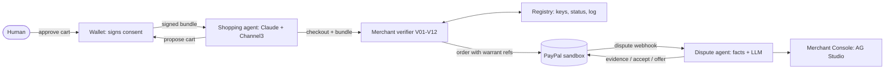

# Warrant

**When an AI agent buys the wrong thing, who pays? Warrant attaches signed proof of the human's authorization to every PayPal order, checks it at checkout, and uses it to resolve disputes with evidence.**

[](LICENSE)


> **Status:** built and tested against a built-in PayPal simulator. The real PayPal sandbox, live Claude and Channel3 runs, and the hosted demo are not yet exercised. The [feature status table](#feature-status) is the source of truth.

| | |
|---|---|
| **Hosted demo** | https://warrant-paypal.onrender.com (free Render instance: the first load after idle takes about a minute). It runs the built-in PayPal simulator, not the real sandbox. No sign-up; the console and Dispute Lab are open |
| **Demo video (under 3 min)** | `<YOUTUBE_URL>`: not recorded yet |
| **Run it now** | `pnpm install && pnpm dev`, then http://localhost:5173. No accounts or keys |
| **Sandbox test logins** | See [docs/setup.md](docs/setup.md#judge-test-accounts) |
| **Built for** | [PayPal AI Hackathon](https://paypalaihackathon.devpost.com/) |

---

## The problem

AI agents are starting to shop for people. Nobody has answered a simple question: **when an agent buys something the human says they never wanted, who pays?**

- PayPal says its Purchase and Seller Protection extend to agentic transactions, within eligibility limits ([PayPal Agent Ready](https://www.paypal.ai/us/agent-ready)). Its own protocol article lists returns and disputes as post-purchase needs without detailing how they work ([PayPal newsroom, Jan 2026](https://newsroom.paypal-corp.com/2026-01-22-Making-Sense-of-the-AI-Shopping-Protocol-Moment)).
- Industry commentary reports that no card network has published a liability rule for agent purchases and that merchants generally bear the loss by default ([Chargeflow, a vendor, July 2026](https://www.chargeflow.io/blog/ai-agent-chargeback-liability)).
- Consumers are cautious: in one 2026 survey 55% were not comfortable with agents buying for them, and in another only 9% were open to fully autonomous purchases including payment (Riskified and Accenture, as reported by trade press).
- Without evidence, merchants have two bad options: block agent checkout, or accept it and eat the disputes.

Proof formats exist (Google's AP2 mandates, Mastercard's Verifiable Intent, Visa's Trusted Agent Protocol). What is missing is the last step: **using that proof at the PayPal checkout and in the PayPal dispute.**

## What Warrant does

1. **A signed Warrant.** The human's wallet signs a *mandate* (what the agent may do). After the human approves a specific cart on a consent screen, the wallet signs the consent and the agent platform signs the *cart warrant*. The agent cannot forge the consent, and it covers one cart hash.
2. **A merchant verifier at checkout.** Twelve deterministic rules (signatures, key status, freshness, audience, replay, cart hash, repricing, mandate scope, consent, payer binding, velocity) return `ACCEPT`, `REVIEW` or `REJECT`. The warrant ids go into the PayPal order's `custom_id` and `invoice_id`.
3. **A dispute agent.** When a PayPal dispute arrives, a deterministic facts engine rebuilds what happened. A language model only reads the buyer's messy text (choosing from a fixed claim list) and writes explanations that are checked against the facts. A rules table picks the outcome:
   - Human authorised this cart: **fight**, submitting evidence through the Disputes API.
   - Agent signed a cart the human did not approve, or exceeded the mandate: **accept and attribute** to the agent platform, instead of losing a fight.
   - No valid proof, or the paying account does not match: **no proof**, with a flag for review.
   - Merchant error (not delivered, listing mismatch): **refund early**.
4. **A registry (Know-Your-Agent lite)** of agent platform keys, status and outcome statistics, plus a hash-chained transparency log so warrants cannot be backdated.
5. **A public verification page** for every warrant, so an analyst can check the proof without trusting us.
6. **A Merchant Console in AG Studio** showing orders by verification result, the dispute queue with proposed actions, and liability attribution by agent platform.

Money-moving actions are **proposals** that a merchant approves. An Autopilot toggle exists for the sandbox demo and defaults off.

**How PayPal could ship this:** [docs/integration-proposal.md](docs/integration-proposal.md).

---

## Architecture at a glance



More: [docs/hackathon-brief.md](docs/hackathon-brief.md) (the hackathon's rules, prizes, sponsors and links), [docs/architecture.md](docs/architecture.md), [docs/warrant-spec.md](docs/warrant-spec.md), [docs/verification-rules.md](docs/verification-rules.md), [docs/dispute-resolution.md](docs/dispute-resolution.md), [docs/paypal-integration.md](docs/paypal-integration.md), [docs/threat-model.md](docs/threat-model.md), [docs/implementation-notes.md](docs/implementation-notes.md) (how the specs were read, open gaps), [docs/test-vectors.json](docs/test-vectors.json), and the library docs in [packages/warrant](packages/warrant/README.md).

---

## Feature status

What works today, and against what.

| Feature | Priority | Status |
|---|---|---|
| Warrant format: sign, hash, parse (`packages/warrant`) | P0 | Working |
| Verifier rules V01-V12 with tests | P0 | Working |
| Shopping agent (Claude + Channel3) and wallet consent screen | P0 | Working (fixtures mode in tests; live mode not yet exercised) |
| Merchant checkout: PayPal order with warrant references, approval, capture | P0 | Working against the built-in PayPal simulator; real sandbox not yet exercised |
| Signed-webhook verification | P0 | Working against the simulator; real sandbox not yet exercised |
| Registry with key status, transparency log and public verify page | P0 | Working |
| Facts engine F1-F13 and outcome table | P0 | Working |
| Dispute agent: facts, claim extraction, notes, evidence packet, approve/autopilot | P0 | Working against the simulator. Reads (`get_dispute`, `get_order`) go through the PayPal Agent Toolkit; responses (evidence, accept, offer) use the Disputes API through `packages/paypal` |
| Merchant Console (AG Studio) with orders, disputes, attribution | P0 | Working |
| Dispute Lab (run scenarios) + hosted demo | P0 | Lab working locally; hosted demo not yet deployed |
| `pnpm eval`: 60+ scenario corpus, ablation, report | P1 | Working (87 scenarios, simulator and fixtures; `sim/report.json`) |
| Custom AG Studio widgets and Studio agent | P1 | Planned (the console embeds a standard AG Studio dashboard) |
| Fixtures mode (runs with no external API keys) | P1 | Working |
| Verifier packaged as middleware | P1 | Planned |
| MCP tools (`verify_warrant`, `get_dispute_facts`) | P2 | Working (`packages/mcp`) |
| Passkey consent signing | P2 | Planned |
| Log in with PayPal for payer binding | P2 | Planned |
| Adapters for AP2 and Verifiable Intent | P2 | Planned |

Status values: Planned, In progress, Working, Cut.

---

## Tools and how they are used

| Tool | Role in Warrant |
|---|---|
| **PayPal REST (sandbox)**: Orders v2, Payments v2, Disputes v1, Webhooks | Checkout with warrant references, capture, tracking, refunds, dispute evidence and responses, signed webhooks, through the typed client in `packages/paypal` |
| **PayPal Agent Toolkit** (`@paypal/agent-toolkit/ai-sdk`) | The dispute agent's reads: `get_dispute` and `get_order`, with only those two actions enabled. It falls back to the typed client if a Toolkit read fails. Not used for `accept_dispute_claim` (the Toolkit sends only a note, without the reason, type or refund amount PayPal needs), `provide-evidence` or `make-offer` (no Toolkit tool) |
| **PayPal AI Toolkit and APIMatic Context Plugin** | Used in the coding agent while building the PayPal client |
| **Claude (Anthropic API)** | Shopping agent, dispute-claim extraction, evidence notes and buyer messages, Studio agent. Model IDs are configurable |
| **Channel3** | Product search for the shopping agent; listing snapshots (`listing_hash`) and merchant-side repricing |
| **AG Studio (AG Grid)** | Merchant Console "Analytics": AG Studio in edit mode over the orders, checkouts and disputes. Custom widgets and a Studio agent are planned, not built |
| **Render** | Hosting: web service and Postgres |

---

## Quickstart

### Option A: hosted demo

https://warrant-paypal.onrender.com runs the built-in PayPal simulator, so no PayPal login is needed. The first load after idle takes about a minute.

1. Open it. There is no sign-up; the console and Dispute Lab are open.
2. In **Shop**, click *"A standing desk converter under $120"*. Press **Link the sandbox buyer now** first for the strongest proof. Sign the permission request, approve the cart, then **Approve payment** on the simulator's page.
3. Open the warrant's **Verify** page to check the proof.
4. Open **Dispute Lab**, pick a scenario (for example *Cart swap*), and run it. Watch the facts, the proposed action and the liability memo. Approve the action.

### Option B: run locally (no accounts, no keys)

Requirements: Node 22+ and pnpm 9+.

```bash
git clone <REPO_URL> warrant
cd warrant
pnpm install
pnpm dev                      # web on :5173, API on :8787
```

Open http://localhost:5173 and ask the agent for *a standing desk converter under $120*. Sign the permission request, approve the cart, pay on the simulator's page, then open the public proof, raise a dispute from **Dispute Lab** and answer it in the **Merchant console**. With no `.env` the server runs in fixtures mode (a built-in catalog and a rule-following agent, no model calls) against the built-in PayPal simulator, with an embedded database and development keys. The first purchase links the PayPal account that pays; press "Link the sandbox buyer now" in the wallet first to see the strongest evidence.

### Option C: the real services

```bash
cp .env.example .env          # add the PayPal sandbox keys (and Anthropic and Channel3 keys for live mode)
pnpm keygen                   # prints signing keys; paste them into .env
docker compose up -d db       # optional: Postgres instead of the embedded database
pnpm paypal:doctor            # checks the PayPal side
pnpm dev
```

Everything is optional and independent: see [docs/setup.md](docs/setup.md). Webhooks need a public URL in development: [docs/setup.md](docs/setup.md#webhooks-in-development). A container: `docker build -t warrant .`, or `docker compose --profile app up` for the app with Postgres.

### Tests

```bash
pnpm test        # every package: library, PayPal client and simulator, catalog, server, web, MCP, evaluation metrics
pnpm eval        # 87 scenarios through the real pipeline; writes sim/report.json; fails if one is wrong
pnpm e2e         # Playwright, in a browser, against the real server (first: pnpm --filter @warrant/e2e exec playwright install chromium)
pnpm test:int    # PayPal sandbox integration tests (needs sandbox credentials; skipped without them)
pnpm paypal:doctor   # checks sandbox credentials with a few harmless calls
pnpm docs:check && pnpm secrets:check   # documentation links; nothing secret committed
```

---

## Project structure

```
apps/server       Fastify API: wallet, registry, merchant verifier, webhooks, dispute agent, console, Lab
apps/web          React + Vite: Shopper, Merchant Console (AG Studio), Dispute Lab, Verify page
packages/warrant  Types, signing, hashing, verifier, facts, outcome table, ledger (pure TypeScript)
packages/paypal   Typed REST client (orders, payments, disputes, webhooks, idempotency) and the sandbox simulator
packages/catalog  Channel3 client, listing snapshots, fixtures
packages/mcp      MCP server: verify_warrant, get_dispute_facts (read-only)
sim/              Evaluation runner and report (the scenarios live in apps/server/src/lab)
e2e/              Playwright browser tests
docs/             Specification, architecture, PayPal integration, threat model, setup, testing
Dockerfile, docker-compose.yml, render.yaml   Container and deployment
```

---

## Limitations and the production path

- **Sandbox only.** No real money moves and no goods ship. One sandbox merchant stands in for the retailer and reprices Channel3 items. PayPal's real agentic checkout products (Agent Ready, Store Sync) are access-gated.
- **Disputes in the sandbox** are created through sandbox tooling or the Resolution Center; sandbox-only endpoints settle them. See [docs/paypal-integration.md](docs/paypal-integration.md#4-disputes-in-the-sandbox). In the Lab, against the built-in simulator, you play both the buyer and the dispute desk.
- **Advisory, not legal.** The liability memo is a recommendation. PayPal's policies, card-network rules and law decide who pays.
- **Demo keys.** In the demo the wallet service signs the consent after the human clicks approve. Production needs device-bound passkeys.
- **Trust on first use** for linking a principal to a PayPal account. A verified link needs PayPal.
- **Self-authored evaluation.** The scenario corpus shows the pipeline behaves as designed. It does not measure real dispute win rates.
- **Registry authority.** A directory is only as trustworthy as its operator. In production this role belongs to a party like PayPal.
- **Budgets need a spend source.** A cumulative budget is only as complete as the spend source: a merchant that sees only its own orders cannot see spend at other merchants.

## Verified and not verified

Measured on this repository (run `pnpm test`, `pnpm eval` and `pnpm e2e` to reproduce):

- **Tests:** about 1,000 across the library (574, 99.9% of lines), PayPal client and simulator, catalog, server (about 300, 95%), web (60, 90%), MCP and the evaluation metrics, plus 11 browser tests.
- **Evaluation:** 87 of 87 labelled scenarios behave as labelled. 41 of 41 honest warrants are accepted; 37 of 37 adversarial warrants are refused by a strict merchant; the 9 sent to permissive or non-enforcing merchants are sold, as those modes mean. Removing the warrant facts changes 20 of 39 dispute decisions, loses 11 of the 12 contestable cases and all 5 agent-platform-fault attributions. The corpus is ours: this shows the design works as intended, not that it wins real disputes.
- **Container:** the Docker image was built and run with Postgres in production mode, and the browser tests passed against it.

**Not verified:** nothing has been run against the real PayPal sandbox (the client follows PayPal's documentation; `pnpm paypal:doctor` and `pnpm test:int` are there to close this), against real Claude or Channel3 keys, on Render, or in GitHub Actions. The PayPal simulator is not PayPal. Details: [docs/implementation-notes.md](docs/implementation-notes.md#64-not-built-or-built-less-than-the-plan-said).

## Hackathon notes

Built for the PayPal AI Hackathon during the submission period (Oct 1 to Nov 12, 2026). New project: the first commit is dated after Oct 1, 2026.

## License

[MIT](LICENSE).
