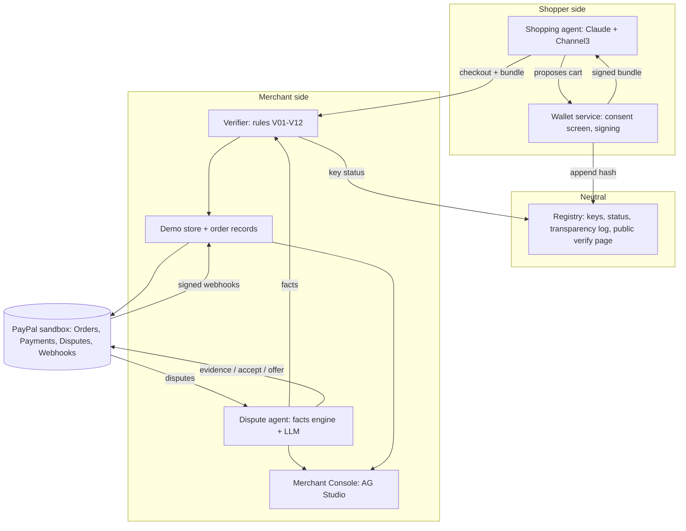
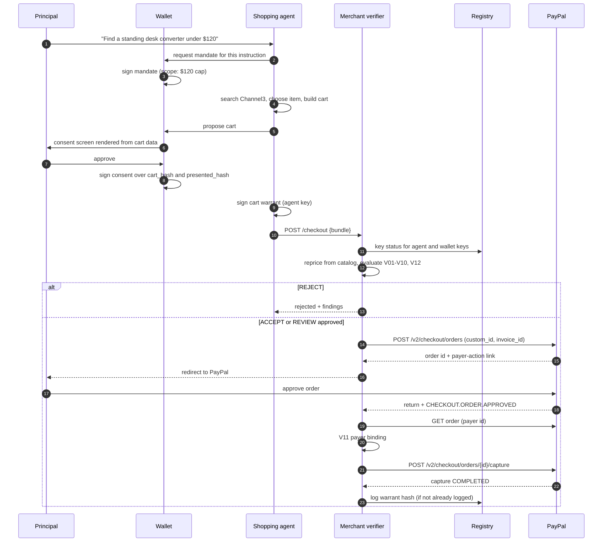
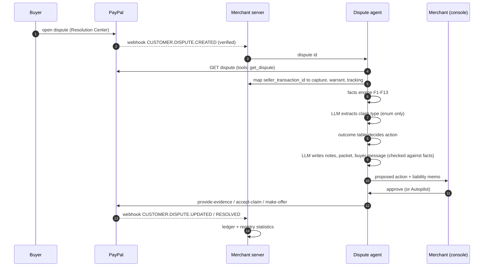

# Architecture

Warrant has three independent roles that normally belong to three different companies: a **wallet** (the human's side), a **registry** (neutral directory), and a **merchant** (verifier plus dispute agent). The prototype deploys them as one service with separate keys, schemas and route prefixes so the trust boundaries stay explicit.

## 1. Components and trust boundaries



| Zone | Trust | Notes |
|---|---|---|
| Shopping agent | **Untrusted** | It proposes carts but cannot produce the consent signature |
| Wallet | Trusted by the principal | Holds the principal signing key. Renders the consent screen from the cart data itself |
| Registry | Trusted as a directory | Publishes public keys and status, and appends warrant hashes to a transparency log |
| Merchant services | Trusted by the merchant | Holds PayPal credentials; recomputes prices itself |
| LLMs (shopping agent, dispute agent) | **Never trusted for facts or money** | Facts and outcomes come from deterministic code |

## 2. Monorepo layout

```
apps/server       Fastify API with route prefixes /wallet, /registry, /merchant, /console
apps/web          React + Vite: Shopper view, Merchant Console (AG Studio), Dispute Lab, public Verify page
packages/warrant  Pure TypeScript: types, signing, hashing, verifier V01-V12, facts F1-F13, outcome table, ledger
packages/paypal   Typed REST client: orders, payments, disputes, webhooks, tracking, idempotency
packages/catalog  Channel3 client, listing snapshots, fixtures
packages/mcp      (optional) MCP tools: verify_warrant, get_dispute_facts
sim/              Scenario corpus and evaluation runner (pnpm eval)
docs/             This documentation
```

## 3. Checkout flow (human present)



## 4. Dispute flow



## 5. Data model

Money in integer minor units. IDs are prefixed ULIDs.

**Wallet schema:** `principals`, `wallet_keys`, `mandates`, `consents` (presented screen hash, approval time, `cart_jti` (unique), `aud`).

**Registry schema:** `platforms`, `platform_keys` (kid, public JWK, status, validity), `transparency_log` (seq, warrant_hash, prev_hash, hash), `platform_stats`.

**Merchant schema:**

| Table | Key columns |
|---|---|
| `orders` | id, paypal_order_id, capture_id, cart_jti, cart_hash, status, verifier_mode, verification_result |
| `warrants` | cart_jti (unique), bundle (jsonb), mandate_hash, nonce (unique), received_at |
| `mandate_spend` | mandate_jti, total_cents, item_count: a per-mandate tally of accepted carts, updated in the same transaction as the nonce and jti, for cumulative mandates |
| `tracking` | order_id, carrier, number, status, delivered_at |
| `disputes` | paypal_dispute_id, capture_id, reason, stage, status, deadline, claim_type |
| `dispute_facts` | dispute_id, facts (jsonb), computed_at |
| `dispute_actions` | dispute_id, outcome, proposed_action, status, approved_by, paypal_response |
| `evidence_packets` | dispute_id, file, sha256 |
| `ledger_entries` | seq, type, payload, prev_hash, hash (append-only, hash-chained) |
| `webhook_events` | paypal_event_id (unique), type, verified, payload, processed_at |

## 6. Idempotency and consistency

- Every PayPal `POST` carries a deterministic `PayPal-Request-Id` (order id plus step plus attempt).
- Nonces are unique per merchant; replays are rejected before any PayPal call.
- Ledger append and state change share one database transaction.
- PayPal is the source of truth for money and dispute state. On mismatch, re-read from PayPal and write a `RECONCILED` entry.
- Webhooks are verified with PayPal's verify API and deduplicated on event id.

## 7. Public verification page

`/v/{cart_jti}` shows, without logging in: signer and registry status, the consented cart, whether the order matches, the transparency-log inclusion, and the verifier's findings. Evidence notes in disputes link to it so a reviewer can check the proof independently.

## 8. Deployment (Render)

```
Dockerfile          one image: the API, the simulator pages and the built web app on one port
render.yaml         Render blueprint: that image as a web service, plus Postgres (warrant-db)
docker-compose.yml  local Postgres; `--profile app` also runs the image
```

The image runs with `NODE_ENV=production`, in which the server refuses to start without `DATABASE_URL`, a public address and the three signing keys. On Render the address comes from `RENDER_EXTERNAL_URL`. There is no background job: webhooks are the live feed, and the console can re-read a dispute on demand.

Secrets live in a Render environment group. No PayPal or Anthropic key reaches the browser.

## 9. Demo versus production

| Prototype | Production |
|---|---|
| One service plays wallet, registry and merchant | Three separate parties; PayPal (or another trusted party) runs the registry |
| Server-held principal key, click consent | Device-bound passkey consent |
| One sandbox merchant reprices Channel3 items | Real retailers via PayPal Agent Ready / Store Sync (access-gated) |
| Trust-on-first-use payer binding | Verified link between wallet identity and PayPal account |
| Advisory liability memo | PayPal policy and applicable rules decide |
| Disputes created via sandbox tooling | Real buyer-initiated disputes |

## 10. Failure modes

| Failure | Behaviour |
|---|---|
| Registry unreachable | The prototype's registry is in the same process and database, so this cannot happen here. A separate registry would need a cached key set for a short time, then `REVIEW` |
| Catalog unreachable during reprice | `REJECT` (fail closed) |
| PayPal capture fails | Order marked failed; no fulfilment; ledger entry |
| Webhook missed | The buyer returning to the shop finishes the order; the console's "Refresh from PayPal" re-reads a dispute. There is no background reconcile job |
| LLM unavailable | Dispute agent still produces facts and a deterministic outcome with template notes |
| Output check fails twice | Case goes to a human with the facts attached |
